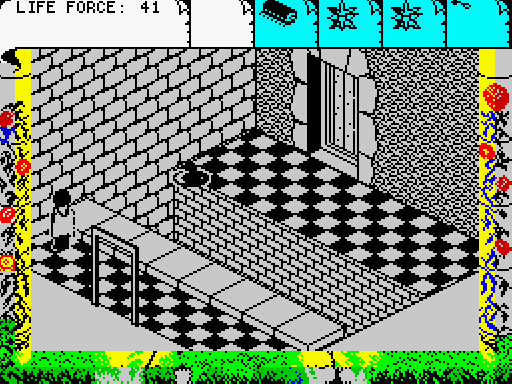
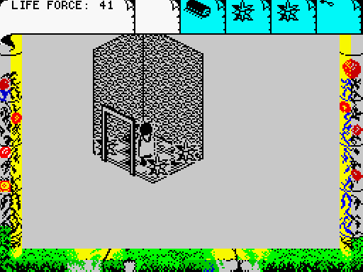
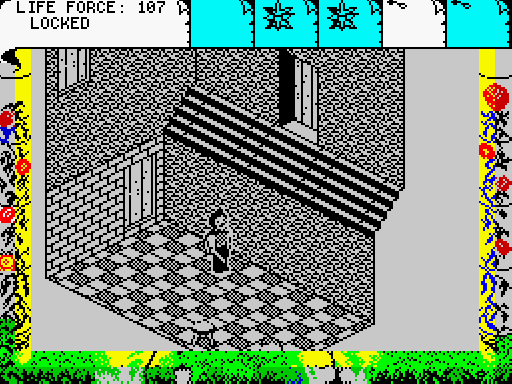
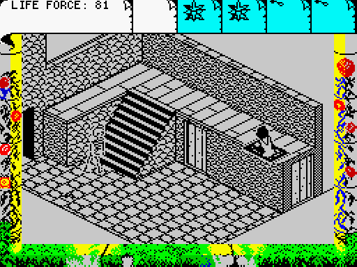

# Bugs (and quirks)

## Part 2 completion

As discussed elsewhere - to get through the final locked door in part 2, you need the magic wand.
Getting this to work relies on some code which runs on handover from part 1 to part 2.
But this doesn't work correctly in the 128K version, and it also fails in the 48K version
if you die and restart while playing part 2.

## Sprite direction in part 2 (128K only)

If you face "left" when completing part 1 (when using the sword), then the player sprite
will permanently face the wrong direction during part 2. This happens because the player
sprites get mirrored in-memory when you change direction, and the 128K version doesn't
sync the player direction and its flags.

## Avoiding death

You only die if your health hits 0 at the end of each run through the main per-frame action.
This means that there's a few ways of avoiding death if you can get your health below 0.

* If a bubble hits you in part 1, then you lose 10 health, but it wraps around modulo 256.
* Similarly if you fall from a height while on the magic carpet, you can lose multiple health,
so you can also avoid hitting 0 health.
* If you're fighting 2 enemies at once it's possible for them to both hit you in the same frame,
and your health can go from 1 to 0 to 255 before the check is done. (It's probably not practical to
do this deliberately).

## The magic carpet

The screen doesn't correctly redraw after you get off the magic carpet.

You can normally get 5 uses of the magic carpet. But if you get off the magic carpet
by using the Pause menu (Sym Shift + Space), you can get 10 uses instead.

In the 128K version, the magic carpet sprite is missing.

## Strange exits

In part 2, there's an odd hidden exit from this room, at the location Isvar is facing:

This skips you ahead by one room compared to the normal route:

This room towards the end of the game has a high exit which you can reach
with the magic carpet:

This takes you back, skipping one empty room. Possibly it was intended that you
land on the high balcony here, although it doesn't quite align correctly for that.

